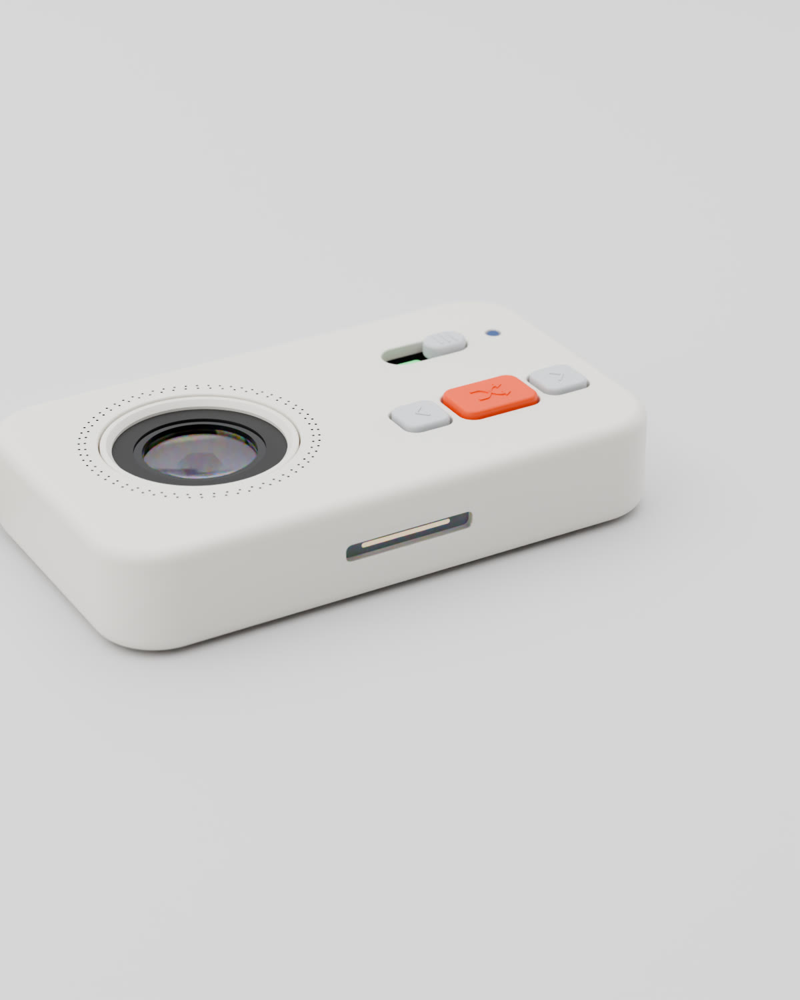

# Memory Projector

A speculative, palm-sized personal projector that tells a life one memory at a time. In this future we don't carry phones;
we wear glasses. You record a moment, choose to send it, and it arrives at the projector, which *develops* it: your glasses
remember flat, the projector makes it whole. Switch it on and the moment rises out of the lens as a hologram, while the
story behind it crawls across the table in front.



The device has four controls: a slide switch for power, back and next keys, and an orange key that shuffles. A small blue
light beside the switch glows while a memory you haven't seen yet is developing. A short woven strap on the back corner
lets you carry it in one hand.

## What's here

| Path | What it is |
| --- | --- |
| `memory-projector.js` | The `<memory-projector>` web component (three.js) |
| `holo-depth.js` | The hologram: plays a depth video as dots on the GPU |
| `lib/` | Small pure modules: depth format, playlist, crawl layout, seen-memories store |
| `index.html` | The projector's own page (`/memory-projector/`): your memories, on a desk |
| `demo/` | Demo page and the synthetic demo memory (a figure built from spheres; no real footage), used by the tests |
| `memories/` | Your memories: `memories.json` and one depth-only `.mp4` per memory |
| `engine/` | The engine page that turns a clip into a memory (see below) |
| `assets/` | Web model (`memory-projector.glb`), baked contact shadow and ambient occlusion |
| `renders/` | Cycles stills of ZL 3 |
| `blender/` | `memory_projector.py` builds the device and studio; `export_web.py` bakes and exports the web model |
| `tests/` | Node and headless-Chromium tests |

The folder is self-contained: nothing in it reaches outside, so it can be copied into another site as is.

## Run the demo

The pages load ES modules, so serve the repository rather than opening files directly:

```bash
python3 -m http.server 4317
```

Then open <http://localhost:4317/memory-projector/> for your memories, or <http://localhost:4317/memory-projector/demo/> for the synthetic demo.
Add `?lab` to the address (or press Shift+L) for the scene lab: camera, light, room and materials, live, with fixtures you
can save and copy out as JSON (`lab.js`).

## Use the component

```html
<script type="importmap">{"imports":{
  "three": "https://cdn.jsdelivr.net/npm/three@0.170.0/build/three.module.js",
  "three/addons/": "https://cdn.jsdelivr.net/npm/three@0.170.0/examples/jsm/"}}</script>
<script type="module" src="memory-projector/memory-projector.js"></script>

<memory-projector memories="memory-projector/memories/memories.json" power="off"></memory-projector>
```

- **Attributes:** `memories` (manifest URL; default `memories/memories.json` next to the script), `power` (`on`/`off`),
  `table` (a fixed view down onto a desk; place it with `--stage-x`, `--stage-y`, `--stage-scale`), `movable` (with
  `table`: press the body to lift it), `zoom`, `muted`, `src` (GLB), `shadow`, `ao`
- **Events:** `memorychange` → `{ id, index, title, story }`, `powerchange` → `{ on }`
- **Methods:** `next()`, `back()`, `shuffle()`, `show(id)`, `togglePower()`, `setMemories(list)`, `anchor(part)` (screen
  position of `power`, `back`, `shuffle`, `next`, `light`, `lens` or `hologram`), `hologramHit(x, y)`, `footprint()`
- **State:** `state` → `{ power, index, id, developing }`
- **Table scene:** `setScene({ camera, light, device, room, look, shell })`, `getScene()`, `tickers`, `floorRay(x, y)`,
  `toScreen(v)`, `keyLight`, `lightDir`, `rig`, `footprintSDF(x, z)`, `roomSDF(x, z)`, the same as the Temporal Projector's
- **Keyboard** (when focused): ← / → back and next, S or Enter shuffle, P power

The component sizes itself to its box and has a transparent background, so it sits on any page colour. The device carries
no page actions: buttons such as "Talk to me" belong to the page around it.

## Memories

`memories/memories.json` lists them in story order:

```json
[
  { "id": "spider-dance", "src": "spider-dance.mp4", "story": "A paragraph, left-aligned on the table.",
    "title": "Spider-Man in the hallway", "date": "2026-10-31", "fps": 12, "seconds": 7, "aspect": 1 }
]
```

`title` is only read out to screen readers and sent with events; the table shows the story alone, without a heading.
Keep a story to a paragraph (about 120 words at most): it crawls at about two words a second.

Each `.mp4` (`"format": 2`) is a greyscale video, 1024 × 512 px, 12 fps, at most 7 s (`lib/depth-format.js`): on the
left, a grey picture of the kept figures (faces blurred unless you turned that off); on the right, their depth, black
where nobody is and a grey from 64 (farthest) to 255 (nearest). No colour, and nothing outside the figures. The first
memories were depth only (`"format": 1`, 256 × 256); the projector still plays them.

## Add a memory with the engine

1. Serve the repository (above) and open <http://localhost:4317/memory-projector/engine/> in Chrome on your Mac.
2. Drop in a clip. Over 7 s, choose where the 7 s start. If it won't load (some iPhone HDR clips), export it from Photos
   as "Most Compatible" first.
3. Write the story; optionally a title and a date.
4. In the first frame, click the figures to keep (and drop the ones you don't want, like a reflection).
5. **Blur faces** is on by default; turn it off for a memory only if you're sure nobody's face shows.
6. Process, watch the stages, and check the public preview: it plays exactly the file anyone could download.
7. Export. Put the downloaded `<id>.mp4` and `memories.json` into `memories/` and commit them.

The engine runs entirely in your browser. Your video is never uploaded, written to disk, or committed.

## Privacy

- Original clips stay on your machine. Never commit them: `.gitignore` refuses common video formats here, except the
  depth-only files in `memories/`, the synthetic demo and test fixtures.
- What is published is a grey picture of the kept figures and their depth. Faces are blurred by default (MediaPipe's
  face finder, looking only at the top of each figure, where heads are); the public check says whether they were.
- The engine's stage view (and its stills and recordings) shows the original video. Those are for you; don't publish them.

## Rebuild the model

Blender is used as a Python module:

```bash
pip install bpy==5.3.0
```

```bash
python3 memory-projector/blender/memory_projector.py -- /tmp/zl3.png hero 1200 1500 64
```

```bash
python3 memory-projector/blender/export_web.py -- memory-projector/assets
```

Cameras: `hero`, `top`, `macro`, `front`, `hero_r`, `keys`, `wide`. The export bakes the contact shadow and ambient
occlusion in Cycles (about ten minutes on a CPU) and prints where each control sits, for the component's constants.

## Tests

```bash
cd memory-projector
```

```bash
npm install && npm test
```

Browser tests use the pre-installed Playwright Chromium and serve the repository locally; the CDN imports are rerouted to
`node_modules`.
