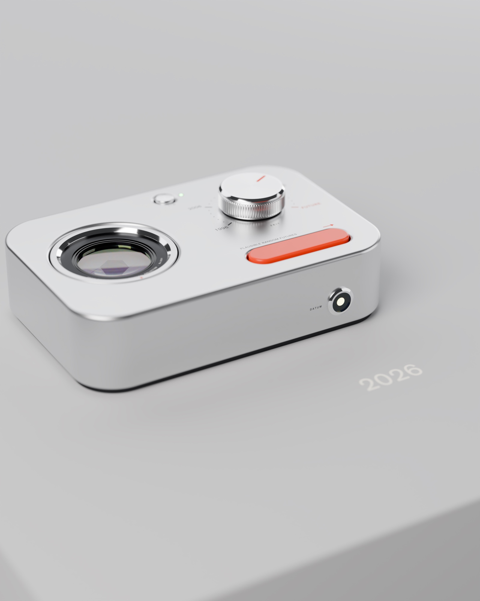

# Temporal Projector

A speculative palm-sized device in the spirit of Dieter Rams. A dial jumps between
1996, 2006, 2016, 2026 and the future; the orange key, **Plausible Random Futures**,
jumps to the future and projects a plausible one. A small front lens projects the
selected date onto the table. The lens on top will project images into the air
(not built yet).



## What's here

| Path | What it is |
| --- | --- |
| `index.html` | Demo page for the interactive component |
| `temporal-projector.js` | `<temporal-projector>` web component (three.js) |
| `assets/` | Web model (`zeitlinse.glb`) and the contact shadow baked in Cycles |
| `renders/` | Cycles stills: hero, top, front, dial macro |
| `blender/zeitlinse.py` | Builds the whole device and studio procedurally in Blender 5.x |
| `blender/export_web.py` | Bakes the shadow and exports the GLB into `assets/` |
| `blender/zeitlinse.blend` | The scene, ready to open |

## Run the demo

The page loads ES modules, so serve the folder rather than opening the file:

```bash
python3 -m http.server 4317 --directory temporal-projector
```

Then open <http://localhost:4317>.

## Use the component

```html
<script type="importmap">{"imports":{
  "three": "https://cdn.jsdelivr.net/npm/three@0.170.0/build/three.module.js",
  "three/addons/": "https://cdn.jsdelivr.net/npm/three@0.170.0/examples/jsm/"}}</script>
<script type="module" src="temporal-projector.js"></script>

<temporal-projector date="2026"></temporal-projector>
```

- **Attributes:** `date` (`1996` `2006` `2016` `2026` `FUTURE`), `power` (`on`/`off`), `zoom`, `muted`, `src`, `shadow`
- **Events:** `datechange` → `{ date, projected }`, `powerchange` → `{ on }`
- **Methods:** `setDate(label)`, `randomFuture()`, `togglePower()`
- **Interaction:** drag or click the dial, press the orange key, press I/O; drag elsewhere to orbit.
  Keyboard: arrows turn the dial, Enter presses the key, P toggles power.

The component sizes itself to its box and has a transparent background, so it sits on any page colour.

## Rebuild from Blender

```bash
/Applications/Blender.app/Contents/MacOS/Blender -b -P blender/zeitlinse.py -- "$PWD/renders/hero.png" hero 1600 2000 1024
```

```bash
/Applications/Blender.app/Contents/MacOS/Blender -b -P blender/export_web.py
```

Cameras: `hero`, `top`, `macro`, `front`. Set `ZL_DATE=1996` (or another date) to change what the dial and projection show.
The labels use Akzidenz-Grotesk from `~/Library/Fonts`; without it, Blender falls back to its default font.
